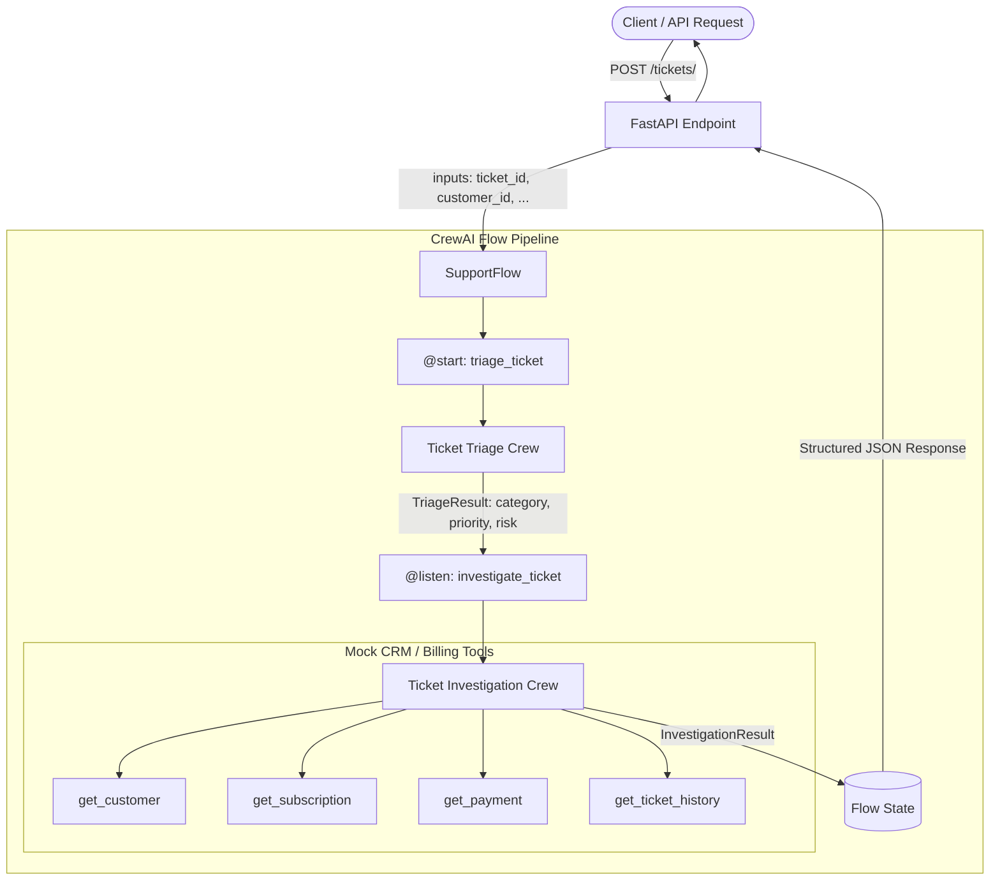

# AI Operations Control Tower 🗼

An automated IT Support & Operations intelligence engine built with **FastAPI** and **CrewAI Flows**. It orchestrates multi-agent crews to triage incoming support tickets, investigate customer histories, verify subscriptions and payments, detect duplicate charges, and return structured resolution intelligence.

---

## 🏗 Architecture & Flow



---

## ✨ Features

- **Automated Ticket Triage**: Evaluates category (`technical`, `billing`, `accounts`, `other`), urgency (`low`, `medium`, `high`, `urgent`), risk level, and assigns confidence scores with reasoning.
- **Deep Investigation Crew**: Dispatches specialized investigative agents with tools to verify customer accounts, subscription active/expired status, transaction ledgers, and past ticket frequency.
- **Duplicate Payment Detection**: Automatically cross-references payment records to detect and report duplicate transactions and amounts.
- **CrewAI Flow Orchestration**: Coordinates state management and sequential crew execution cleanly using event-driven `@start` and `@listen` decorators.
- **Pydantic Validation**: Strict typing across inputs ([`SupportTicket`](app/models/ticket.py)) and outputs ([`TriageResult`](app/schemas/triage.py) & [`InvestigationResult`](app/schemas/investigation.py)).
- **Production-Ready API**: Powered by FastAPI with automatic OpenAPI interactive docs (`/docs` & `/redoc`).
- **Containerized**: Includes `Dockerfile` and `.dockerignore` for instant cloud deployment.

---

## 📁 Project Structure

```text
ai_ops_tower/
├── .github/workflows/
│   └── ci.yml               # GitHub Actions CI workflow
├── app/
│   ├── api/
│   │   └── routes/
│   │       └── tickets.py   # FastAPI route for ticket triage & investigation
│   ├── crews/
│   │   ├── investigation/   # Investigation Crew (Agent, Task, Tools, Runner)
│   │   │   ├── agents.py
│   │   │   ├── crew.py
│   │   │   ├── task.py
│   │   │   └── tools.py     # Data lookup tools (customer, billing, payment)
│   │   └── triage/          # Triage Crew (Agent, Task, Runner)
│   │       ├── agents.py
│   │       ├── crew.py
│   │       └── tasks.py
│   ├── flows/
│   │   └── support_flow.py  # CrewAI Flow coordinating triage & investigation
│   ├── models/
│   │   └── ticket.py        # Input SupportTicket model
│   ├── schemas/
│   │   ├── investigation.py # Structured output schema for investigation
│   │   └── triage.py        # Structured output schema for triage
│   ├── config.py            # App settings via pydantic-settings
│   ├── main.py              # FastAPI app instance and router inclusion
│   └── test.py              # Investigation crew test script
├── .dockerignore
├── .env.example             # Environment variable template
├── .gitignore               # Excludes secrets, venv, and cache files
├── Dockerfile               # Production Docker container definition
├── pytest.ini               # Pytest configuration
├── requirements.txt         # Project dependencies
└── README.md
```

---

## 🚀 Getting Started

### Prerequisites

- Python 3.10+ (Python 3.11 or 3.12 recommended)
- OpenAI API Key

### 1. Clone the Repository

```bash
git clone https://github.com/Mettice/crewai_operations.git
cd crewai_operations
```

### 2. Set Up Virtual Environment

```bash
# On Linux/macOS
python3 -m venv venv
source venv/bin/activate

# On Windows (PowerShell)
python -m venv venv
.\venv\Scripts\Activate.ps1
```

### 3. Install Dependencies

```bash
pip install --upgrade pip
pip install -r requirements.txt
```

### 4. Configure Environment Variables

Copy `.env.example` to `.env`:

```bash
cp .env.example .env
```

Open `.env` and fill in your keys:

```ini
OPENAI_API_KEY=sk-your-openai-api-key
MODEL_NAME=gpt-4.1-mini
APP_NAME="AI Operation control tower"
APP_ENV=development
LOG_LEVEL=INFO
```

---

## 🏃 Running the Application

### Local Development Server

Start the FastAPI application with hot reload:

```bash
uvicorn app.main:app --reload
```

The service will be accessible at:
- **API Root**: [http://127.0.0.1:8000](http://127.0.0.1:8000)
- **Interactive Swagger Docs**: [http://127.0.0.1:8000/docs](http://127.0.0.1:8000/docs)
- **ReDoc Documentation**: [http://127.0.0.1:8000/redoc](http://127.0.0.1:8000/redoc)

---

## 📡 API Reference

### Health Check

```http
GET /health
```

**Response (200 OK):**
```json
{
  "status": "ok",
  "environment": "development",
  "app_name": "AI Operation control tower"
}
```

---

### Process Support Ticket

```http
POST /tickets/
Content-Type: application/json
```

**Request Body:**
```json
{
  "ticket_id": "TKT-001",
  "customer_id": "customer1",
  "subject": "Billing issue",
  "description": "I was charged twice for my subscription this month. Please help."
}
```

**Response (200 OK):**
```json
{
  "ticket_id": "TKT-001",
  "triage_result": {
    "category": "billing",
    "priority": "high",
    "risk_level": "medium",
    "confidence": 0.95,
    "reasoning": "Customer reports being charged twice for their monthly subscription."
  },
  "investigation_result": {
    "customer_verified": true,
    "customer_name": "John Doe",
    "subscription_status": "active",
    "subscription_plan": "premium",
    "payment_issue_detected": true,
    "duplicate_payment": true,
    "duplicate_amount": 49.99,
    "open_tickets_count": 0,
    "evidence": [
      "Customer record verified for customer1 (John Doe)",
      "Active premium subscription found ($49.99/mo)",
      "Found multiple transactions TX-001 and TX-002 with status completed for 49.99"
    ],
    "investigation_summary": "Customer John Doe was charged twice for $49.99 on transactions TX-001 and TX-002. Duplicate payment confirmed."
  }
}
```

---

## 🧪 Testing

Run automated tests with `pytest`:

```bash
pytest
```

To run the standalone customer investigation test script:

```bash
python app/test.py
```

---

## 🐳 Docker Deployment

Build and run the container locally:

```bash
# Build the Docker image
docker build -t ai-ops-tower .

# Run the container
docker run -d -p 8000:8000 --env-file .env ai-ops-tower
```

---

## 🚢 Preparing for GitHub Deployment

1. **Ensure `.env` is NOT tracked**:
   Verify that `.env` is ignored by git before committing:
   ```bash
   git status
   ```
   *(Ensure `.env` does not appear in the untracked files list).*

2. **Initialize Git and Commit**:
   ```bash
   git init
   git add .
   git commit -m "Initial commit: AI Ops Control Tower with FastAPI and CrewAI flows"
   ```

3. **Push to GitHub**:
   ```bash
   git branch -M main
   git remote add origin https://github.com/Mettice/crewai_operations.git
   git push -u origin main
   ```

4. **Configure GitHub Repository Secrets**:
   If using the included GitHub Actions CI workflow, add your API key in **GitHub Repository Settings** -> **Secrets and variables** -> **Actions**:
   - `OPENAI_API_KEY`: Your OpenAI API key

---

## 📄 License

This project is licensed under the MIT License.
